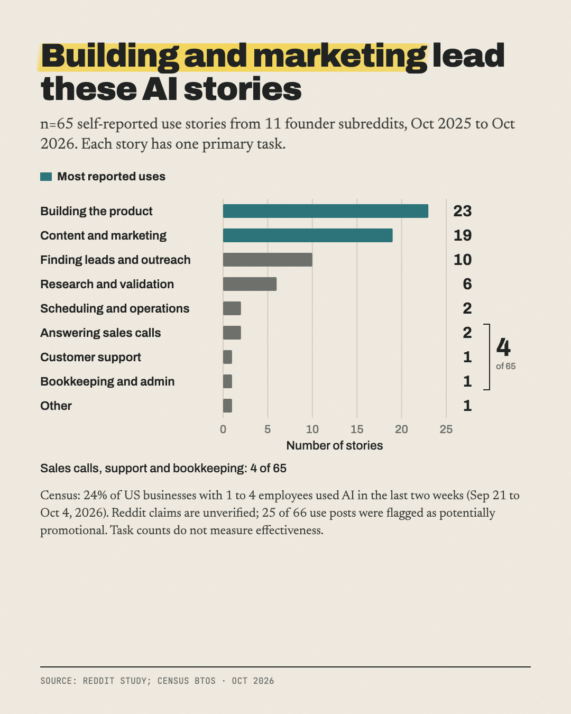

# How small businesses actually use AI, and whether it pays

**24.3% of US firms with 1 to 4 employees used AI in the last two weeks (Census BTOS).**

Part of [The Actuals](https://readtheactuals.com), research on the real numbers behind small online businesses. [Get the next study by email](https://readtheactuals.com).

**Census data** (`data.csv`, 5,008 rows): the two Business Trends and Outlook Survey (BTOS) core AI questions, for every period, nationally, across 7 business size classes and 20 sectors. It also includes 1–4 employee businesses by sector for the latest period, and the pooled AI supplement covering Nov 17, 2025 to Feb 8, 2026.

**Reddit data:**
- **Collected:** 1,200 top-of-year posts from 12 subreddits.
- **Coded:** 484 of them mention AI (`reddit_posts.csv`).
- **Summarized:** `reddit_task_summary.csv`.

## Findings
1. **About 1 in 4 of the smallest US businesses now use AI.**
   - Census: 24.3% of firms with 1–4 employees used AI in the last two weeks (Sep 21 to Oct 4, 2026), up from 17.0% in November 2025.
   - Firms with 250+ employees went from 30.5% to 43.6%, so the gap grew from 13.5 to 19.3 points under the same question wording.
2. **Founders use AI to build and promote, not to replace staff.**
   - Among 65 founder stories about real AI use (from 66 of the 1,100 top posts across 11 founder subreddits), 35% use it to build the product, 29% for content and marketing, and 15% for leads and outreach.
   - Support, bookkeeping and answering sales calls together make up only 6% (4 stories).
   - Census agrees: sales and marketing is the top AI use for 1–4 employee firms (13.1%). 83.6% of small firms whose staff use AI chat tools use them for emails and documents.
3. **Almost nobody can show the payoff.**
   - Only 3 of the 65 stories put a number on the time or money AI saved ($3,200/month, $756/year, 8 hours/week), and a 4th described savings without an amount.
   - 25 of the 66 posts look like disguised ads.
   - There are 41 skeptical posts against 65 success stories.
   - Census: 95.7% of firms using AI say it didn't change their headcount. Among 1–4 employee firms not planning to use AI, 63.3% say it isn't applicable to them, and only 3.3% were let down by past use.

## Supporting figures
- **All firms:** 24.6% (Sep 21 to Oct 4, 2026), up from 17.3% in November 2025.
- **Plan to use AI in the next 6 months:** 28.6% of all firms, 28.1% of 1–4 employee firms.
- **Old question wording:** 3.7% (Sep 2023) to 10.0% (Sep 2025). Reference only; it can't be joined to the new series.
- **AI use among 1–4 employee firms, by sector:**
  - Top: professional, scientific and technical services 42.4%; information 41.5%; finance and insurance 38.5%.
  - Bottom: restaurants and hotels 8.2%; transportation 11.1%; other services 13.1%; construction 14.0%.
- **Reddit outcomes:**
  - Building the product: 9 of 23 stories were mixed or failed. Content: 1 of 19.
  - r/AI_Agents (tracked separately): 24 of its 99 AI posts are skeptical, and 3 of its 16 real deployments failed.

## Limits
**Census changes:**
- **Question rewording, Nov 17, 2025:** "in producing goods or services" became "in any of its business functions". This started a new series, so the old 10.0% and the new 17.3% can't be read as growth.
- **Relabelling, Oct 19, 2026 collection:** the question now reads "Super Intelligence or SI (formerly AI)" (Executive Order 14434). Every value published so far was still asked as "AI".
- **Missing period:** there's no data for Oct 6 to Nov 16, 2025, because of the federal shutdown.
- **Coverage:** Census counts only businesses with employees, not solo founders or side hustles with no payroll.
- **Suppressed cells:** some are blank. "Management of companies" has a wide margin of error (±12–13 points), so don't feature it.
- **Definitions vary:** Census measures AI use in the last two weeks, not ever. Each supplement question has its own base.

**Reddit limits:**
- **Unverified:** all claims are self-reported. The ad flag is somewhat broad.
- **Missing feed:** there was no r/sweatystartup feed, so local service businesses are probably under-represented.
- **Separated sub:** r/AI_Agents is kept out of the headline numbers.
- **Cross-posts:** the clinic-automation story was cross-posted 3 times and recoded as skeptical, since it used no AI. One other story appeared in two subreddits and is counted once.
- **Sampling bias:** top feeds favour dramatic stories, and posts were pre-screened by AI keywords.
- **Small sample:** with n=65, one story is about 1.5 points.

## Files

- `data.csv (5008 rows)`
- `reddit_posts.csv (484 rows, dropped notes, title_short)`
- `reddit_task_summary.csv (27 rows)`
- `scripts/build_census.py`
- `scripts/extract_rss.py`
- `scripts/merge_reddit.py`
- `scripts/peek.py`
- `scripts/q.py`
- `sources.md`

## License

Data: [CC BY 4.0](https://creativecommons.org/licenses/by/4.0/), credit "The Actuals, readtheactuals.com". Code: MIT. Prices, fees and company names are facts and trademarks of their owners.
