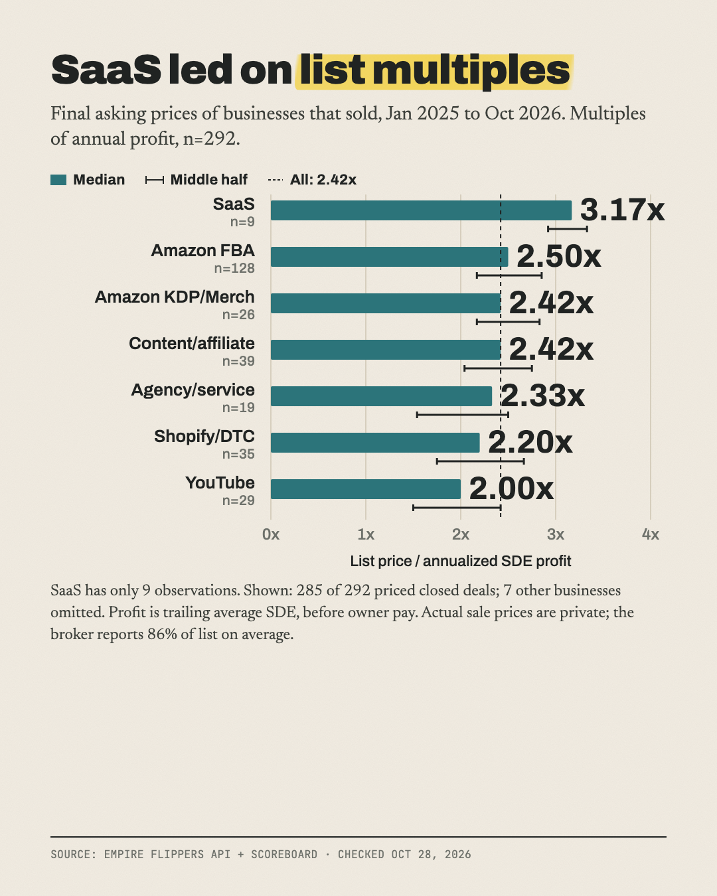

# What 292 online businesses were priced at when they sold

**The typical online business that sold on Empire Flippers was listed at about 2.4x its yearly profit.**

Part of [The Actuals](https://readtheactuals.com), research on the real numbers behind small online businesses. [Get the next study by email](https://readtheactuals.com).

## Data
- **Source:** 294 listings marked Sold on Empire Flippers' public Marketplace API, Jan 2025 to Oct 2026, checked 2026-10-28. 292 have a price.
- **Prices are list prices, not sale prices.** Every price is the final list price of a closed deal (price_type = asking). Row-level sale prices aren't public.
- **Broker averages:** Empire Flippers' scoreboard says deals close at 86% of list price on average, with a typical 2.2x sold multiple over 12 months.
- **Median business:** list price $127,589, profit $4,773/mo on $15,024/mo revenue, 4.1 years old, 5 hours/week of owner time.
- **Multiple** = list price ÷ trailing average annual SDE (profit before the owner's pay).

## Findings
1. **The overall median multiple is 2.42x** (middle half 2.00–2.83x). It varies by type:

   | Type | n | p25 | Median | p75 |
   |---|---|---|---|---|
   | SaaS | 9 | 2.92 | 3.17 | 3.33 |
   | Amazon FBA | 128 | 2.17 | 2.50 | 2.85 |
   | Amazon KDP/Merch | 26 | 2.17 | 2.42 | 2.83 |
   | Content/affiliate site | 39 | 2.04 | 2.42 | 2.75 |
   | Agency/service | 19 | 1.54 | 2.33 | 2.50 |
   | Shopify/DTC store | 35 | 1.75 | 2.20 | 2.67 |
   | YouTube channel | 29 | 1.50 | 2.00 | 2.42 |

2. **Most deals are small.** 40% made $2–5k/month profit, with a median list price of $82,388. 75% made under $10k/month. Only businesses making $25k+/month break out on multiple.

   | Monthly profit | n | Median list price | Median multiple |
   |---|---|---|---|
   | Under $2k | 33 | $48,133 | 2.58x |
   | $2–5k | 118 | $82,388 | 2.33x |
   | $5–10k | 67 | $192,220 | 2.50x |
   | $10–25k | 57 | $403,037 | 2.50x |
   | $25k+ | 17 | $1,725,031 | 3.25x |

3. **Age raises the multiple; owner hours don't** (Spearman 0.32 for age, 0.01 for hours).
   - Under 3 years: 2.17x. 3–5 years: 2.46x. 5–8 years: 2.50x. 8+ years: 2.67x.
   - Excluding YouTube channels: 2.25x (under 3 years) vs 2.67x (8+ years).
   - By owner hours/week: under 5 = 2.42x, 5–9 = 2.33x, 10–19 = 2.33x, 20–39 = 2.67x, 40+ = 2.33x.

**Bonus finding:** listings priced at 3x or more sold in a median of 46.5 days, while those under 2x took 103 days.

| Multiple at listing | Median days to sell |
|---|---|
| Under 2x | 103 |
| 2–2.5x | 106 |
| 2.5–3x | 54.5 |
| 3x+ | 46.5 |

## Limits
- **List prices, not sale prices.** Using the broker's 86% average, the real multiple is roughly 2.1x. That figure is an estimate.
- **One curated broker:** prices start at about $20k, Amazon FBA makes up 128 of 292 listings, and 84% of sellers are US-based.
- **Small groups:** SaaS (n=9), app (n=1) and newsletter (n=1) are too small to generalize from.
- **Profit window:** profit is SDE averaged over 6–12 months, so it isn't comparable to EBITDA-based multiples.
- **Self-reported fields:** owner hours and business age come from sellers.
- **Missing details:** sold dates are month-level only, and there's no traffic-source field.
- **Other marketplaces were skipped by their terms:** Flippa, Acquire, Microns, FE International, Quiet Light and Motion Invest.

## Files

- `analyze.py`
- `build.py`
- `data.csv (294 rows)`
- `sources.md`
- `txt.py`

## License

Data: [CC BY 4.0](https://creativecommons.org/licenses/by/4.0/), credit "The Actuals, readtheactuals.com". Code: MIT. Prices, fees and company names are facts and trademarks of their owners.
