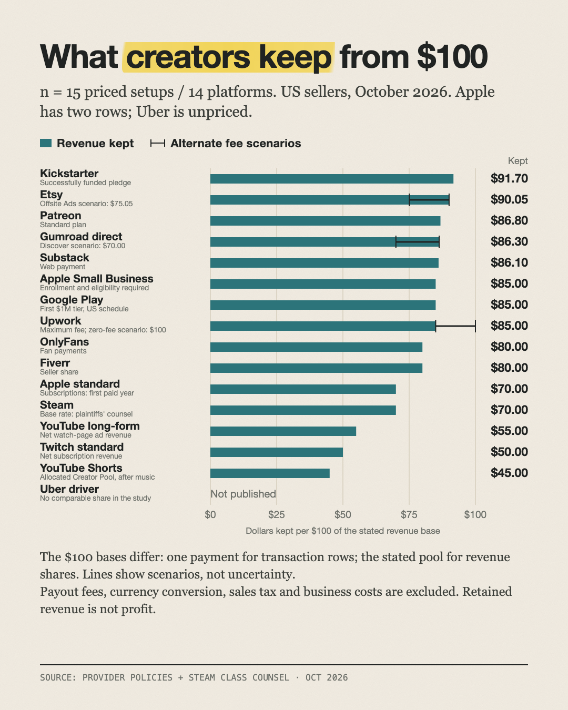

# What creators keep from $100 on 15 platforms

**From $91.70 on Kickstarter to $45 on YouTube Shorts.**

Part of [The Actuals](https://readtheactuals.com), research on the real numbers behind small online businesses. [Get the next study by email](https://readtheactuals.com).

16 rows: 15 platforms, with Apple shown twice (standard and small-business rate). Uber is left blank.

Fees are as of October 2026, for a US seller on the standard plan, with no promotions and excluding payout fees. Etsy, Kickstarter and Patreon come from Wayback Machine snapshots dated 2026-10-11 to 2026-10-24.

## Findings
1. **The gap is wide.** $100 leaves $91.70 with a Kickstarter creator and only $45.00 with a YouTube Shorts creator. Twitch subscriptions leave $50.00 and long-form YouTube $55.00.
2. **App stores:**
   - Apple's standard 30% leaves $70.00.
   - Apple's Small Business Program (under $1M in proceeds) and Google Play's first-$1M tier both leave $85.00.
3. **Fan-payment platforms end up nearly tied.** Patreon ($86.80), Gumroad direct ($86.30) and Substack ($86.10) land within 70¢ of each other once card processing is added to their 10% fee.
4. **Etsy keeps $90.05**, or $75.05 when a sale is credited to Etsy's Offsite Ads.

## Caveats
- **What "$100" means differs by platform type.** For fan payments it's one $100 payment. For ad and revenue-share platforms it's $100 of the revenue being split.
- **Fixed fees are counted once.** Patreon on 20 pledges of $5 keeps $81.10.
- **Upwork is at its maximum** of 15%.
- **Google Play's US fees changed** on 2026-06-30.

## Unverified
- **Uber:** no driver share is published. The roughly 20% take rate excludes insurance, which is 14–31% depending on the state.
- **Steam 30%:** comes from plaintiffs' counsel in Wolfire v. Valve. Valve's own pages show only the 25% and 20% tiers.
- **Twitch 50%:** from Twitch's 2024 blog, because the help page was unreachable.
- **Etsy:** the one-time setup fee amount isn't published.

## Files

- `data.csv (16 rows)`
- `sources.md`

## License

Data: [CC BY 4.0](https://creativecommons.org/licenses/by/4.0/), credit "The Actuals, readtheactuals.com". Code: MIT. Prices, fees and company names are facts and trademarks of their owners.
