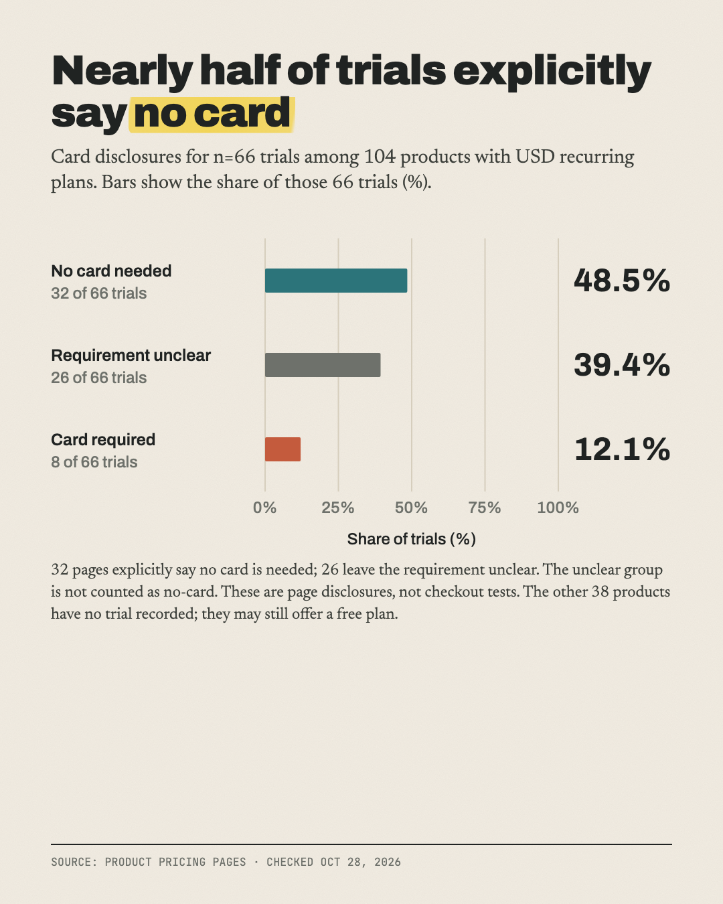

# What 104 indie SaaS products charge for their cheapest plan

**Median entry plan $19/month; only 8 of 66 free trials ask for a card upfront.**

Part of [The Actuals](https://readtheactuals.com), research on the real numbers behind small online businesses. [Get the next study by email](https://readtheactuals.com).

- **Products collected (data.csv):** 123.
  - 52 came from links in the top-of-year feeds; 71 are well-known indie SaaS products.
- **Headline sample:** 104 products with a recurring plan priced in USD.
- **Excluded:** 9 more reviewed and dropped (reasons in sources.md).

## Findings
1. **Median entry price is $19/mo** (n=104). The middle half run $10 to $29.75.
   - $19 (13 products) and $29 (12) are the most common prices.
   - 58% start under $20.
2. **97 of 104 offer a free plan or a trial.**
   - Of the 66 trials, 32 say "no card" and only 8 require a card; 26 don't say.
3. **"2 months free" is the standard yearly deal.**
   - 71 of 104 offer a yearly discount, with a median of 17.2%; 29 are exactly 16.7%.
   - Tiers badged "most popular" (53 products) have a median price 2.0x the cheapest plan.

## Caveats
- **Card requirement unclear for 26 trials:** marked `unknown`.
- **6 EUR/GBP products:** left out of the USD statistics.
- **5 products whose price the crawler didn't capture** (not checked by hand): Typefully, Potion, Blackmagic, updown.io, LowFruits.
- **"Indie" isn't verified per company:** the feed products skew toward winners.
- **Some prices come from HTML or embedded data:** noted per row.
- **One pacing lapse on datafa.st** (about 37 script fetches roughly 0.4 s apart): disclosed in sources.md.

## Files

- `data.csv (123 rows)`
- `sources.md`

## License

Data: [CC BY 4.0](https://creativecommons.org/licenses/by/4.0/), credit "The Actuals, readtheactuals.com". Code: MIT. Prices, fees and company names are facts and trademarks of their owners.
