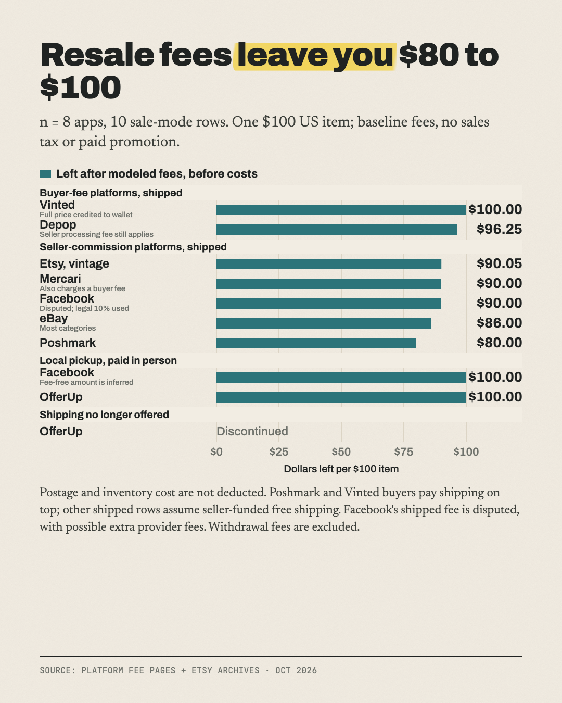

# What you keep from a $100 sale on 8 resale apps

**From $80 on Poshmark to $100 on Vinted or local pickup.**

Part of [The Actuals](https://readtheactuals.com), research on the real numbers behind small online businesses. [Get the next study by email](https://readtheactuals.com).

There are 10 rows: Facebook and OfferUp each have a shipped row and a local-pickup row.

**Shipping assumption:** where the seller sets the shipping price, they offer free shipping, so the buyer pays $100 total. Postage cost isn't subtracted. Poshmark and Vinted always charge shipping to the buyer.

## Findings
1. **You keep anywhere from $80.00 to $100.00.** Poshmark's 20% fee leaves the least. Vinted, Facebook local pickup and OfferUp local pickup leave the full $100.
2. **Depop and eBay:**
   - Depop keeps $96.25. It has no US selling fee, only 3.3% + $0.45 processing.
   - eBay keeps $86.00 (13.6% + $0.40). That drops to $84.91 if the buyer pays 8% sales tax, because eBay charges its fee on the tax-inclusive total.
3. **OfferUp and Facebook shipping:**
   - OfferUp has dropped shipping entirely. No new shipped listings since 2025-09-23, and shipping was removed from all listings by 2025-10-21.
   - Facebook's own pages contradict each other on the shipped fee: 10% in the legal terms ($90 kept) vs "only 5%" on a marketing page ($95). The legal 10% is used.

## Unverified
- **Facebook local pickup at $100:** inferred from the legal terms, which only cover checkout sales.
- **Facebook shipped fee:** the 10% vs 5% conflict above.
- **Poshmark:** taken from its blog FAQ, because the help center failed its security certificate check.
- **Payout fees:** Vinted withdrawal fees and Mercari Instant Pay fees weren't confirmed.

## Files

- `data.csv (10 rows)`
- `sources.md`

## License

Data: [CC BY 4.0](https://creativecommons.org/licenses/by/4.0/), credit "The Actuals, readtheactuals.com". Code: MIT. Prices, fees and company names are facts and trademarks of their owners.
