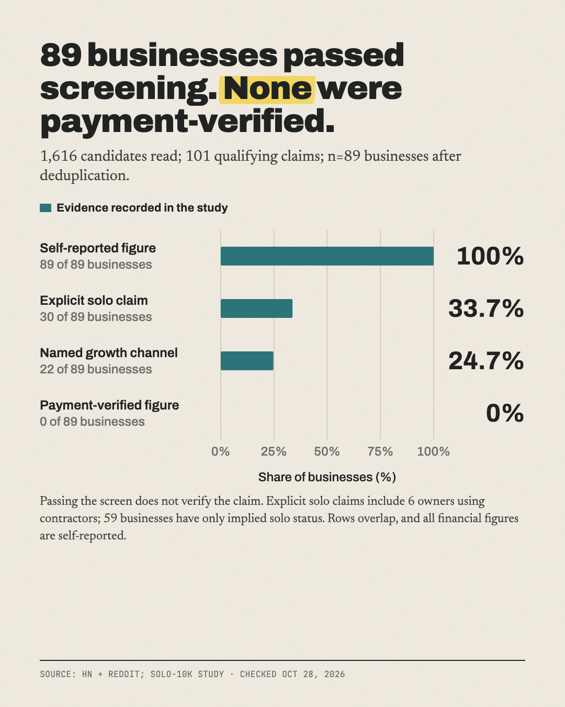

# One-person businesses claiming $10K+/month: what holds up

**1,616 claims read, 89 businesses held up, none payment-verified.**

Part of [The Actuals](https://readtheactuals.com), research on the real numbers behind small online businesses. [Get the next study by email](https://readtheactuals.com).

## Data
- **n = 89** unique one-person businesses, drawn from 101 qualifying claims. Those came from 1,616 candidates read in full, out of 23,129 items scanned (15,829 Hacker News comments and 7,300 Reddit top-of-year posts).
- **All figures are self-reported. None are payment-verified.** The verified directories (TrustMRR, StartuPage, Arrfounder) forbid collection in their terms. Indie Hackers blocks AI agents in robots.txt. Starter Story allows non-commercial use only. Acquire and Flippa ban copying.
- **Stats** use the rows with included_in_stats=1. Tables are in summary.csv.
- **Do not publish the work/ folder.** It contains full post and comment text.

## Findings
1. **Software is the most common, but it isn't the top earner.**
   - SaaS: 30 of 89 (34%). Including apps: 38 of 89 (43%).
   - Median revenue: SaaS $16,250/mo (n=30), ecommerce/DTC $50,000 (n=11), apps $44,834 (n=8).
2. **Most only just clear $10K.**
   - Median $20,833/mo (IQR $13,644–$50,000).
   - 42% report $10–20K/mo. Only 11% report $100K+.
3. **Few say how they grew.** Only 22 of 89 name a channel:

| Channel | Mentions |
|---|---|
| Paid ads | 8 |
| Word of mouth | 4 |
| Marketplaces/app stores | 4 |
| SEO | 3 |
| Reddit | 3 |
| Cold outreach | 2 |
| Instagram | 2 |
| X | 1 |
| TikTok | 1 |
| Product Hunt | 1 |
| YouTube | 0 |
| Newsletters | 0 |
| LinkedIn | 0 |

**Backup findings:**
- **Age at claim:** median 4 years (n=25). 12 of 25 were 3 years old or less.
- **Explicitly solo:** 30 of 89. Their median is $27,500/mo.
- **Why candidates were excluded:**
  - someone else's business: 416
  - under $10K: 288
  - no usable figure: 255
  - teams: 170

## Limits
- **Revenue:** no figure is verified, some claims are promotional, 19 are thin, and 2 are projections.
- **Bias:** survivorship and selection. HN skews toward SaaS, and Reddit skews toward viral posts.
- **Solo status:** 59 of 89 are only implied. A few large claims are probably not truly one person. The explicit-only median serves as the check.
- **Channels and timing:** only 22 rows name a channel, so treat that as directional. Time to $10K (n=1) and entry price (n=1) weren't measurable.
- **Mixed data:** claims are dated 2010–2026 and mix MRR, revenue, ARR/12 and profit (kept separate in `revenue_metric`). Currency was converted at the ECB rate on 2026-10-28.
- **Small groups:** category groups of 6–11 are indicative only.

## Files

- `data.csv (101 rows, dropped notes)`
- `excluded.csv (1515 rows)`
- `scripts/build.py`
- `scripts/grepterms.py`
- `scripts/hn_extract.py`
- `scripts/merge.py`
- `scripts/moneyre.py`
- `scripts/rd_extract.py`
- `sources.md`
- `summary.csv (48 rows)`

## License

Data: [CC BY 4.0](https://creativecommons.org/licenses/by/4.0/), credit "The Actuals, readtheactuals.com". Code: MIT. Prices, fees and company names are facts and trademarks of their owners.
