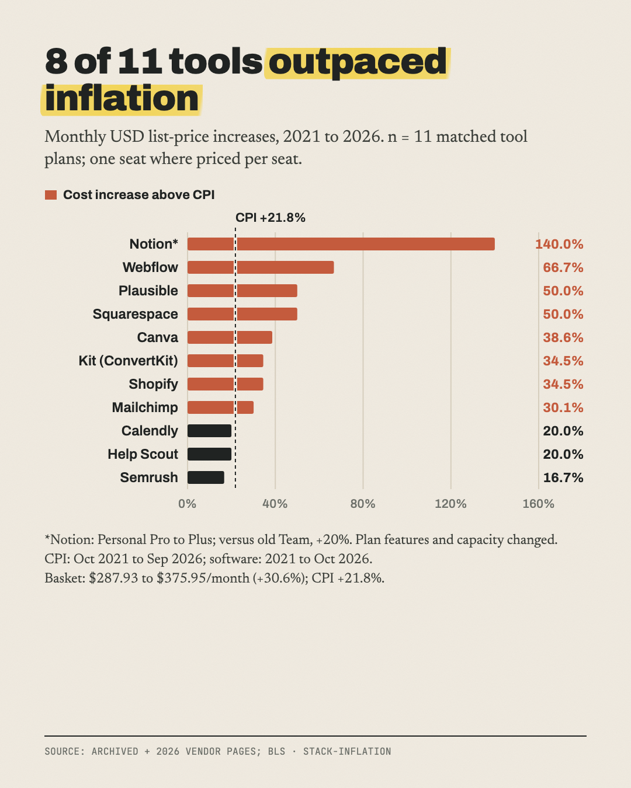

# What a solo business's software stack cost in 2021 vs 2026

**The same 11 tools rose 30.6% while US inflation was 21.8%.**

Part of [The Actuals](https://readtheactuals.com), research on the real numbers behind small online businesses. [Get the next study by email](https://readtheactuals.com).

15 tools collected; 11 have a like-for-like price in both 2021 and 2026.

## Findings
1. **The 11-tool stack rose 9 points more than CPI.**
   - Billed monthly: $287.93/mo (Oct 2021) → $375.95 (Oct 2026), +30.6%.
   - US CPI rose +21.8% over the same period (BLS 276.589 → 336.940; Sep 2026 is the latest).
2. **8 of the 11 tools rose faster than inflation**, median +34.5%.
   - Notion: $5 → $12 (+140%).
   - Webflow: $15 → $25 (+66.7%).
   - Plausible and Squarespace: +50%.
3. **Some plans now give you less.**
   - Canva Pro: $12.99 "for up to 5 people" → $18 "for one person".
   - Mailchimp Essentials (500 contacts): $9.99 → $13. Its free plan shrank from 2,000 contacts to under 250.

## Caveats
- **No 2021 price for 3 tools.**
  - Typeform and Linktree: no Wayback snapshots.
  - Zapier: its prices loaded from an unarchived request.
- **Framer** was a prototyping tool in 2021, so it isn't compared.
- **Notion depends on the baseline.** Against its 2021 Team plan ($10) it's only +20%. The stack is still +28.6% without Notion.
- **Semrush dominates the total.** Without it, the other 10 tools rose +40.5%.
- **Prices derived from stated savings:** Calendly 2021 ($10) and Kit 2026 ($39).
- **Kit 2026** comes from the 2026-10-26 Wayback capture (the live site blocks bots).
- **Help Scout 2021 monthly ($25)** comes from archived pricing data from June 2021.
- **Renamed plans were matched:** Calendly Premium→Standard, Semrush Pro→SEO, Squarespace Business→Core, Notion Personal Pro→Plus.
- **Yearly billing** (the 9 tools that offered it in both years): $201.95 → $258.33, +27.9%.

## Files

- `data.csv (15 rows)`
- `sources.md`

## License

Data: [CC BY 4.0](https://creativecommons.org/licenses/by/4.0/), credit "The Actuals, readtheactuals.com". Code: MIT. Prices, fees and company names are facts and trademarks of their owners.
