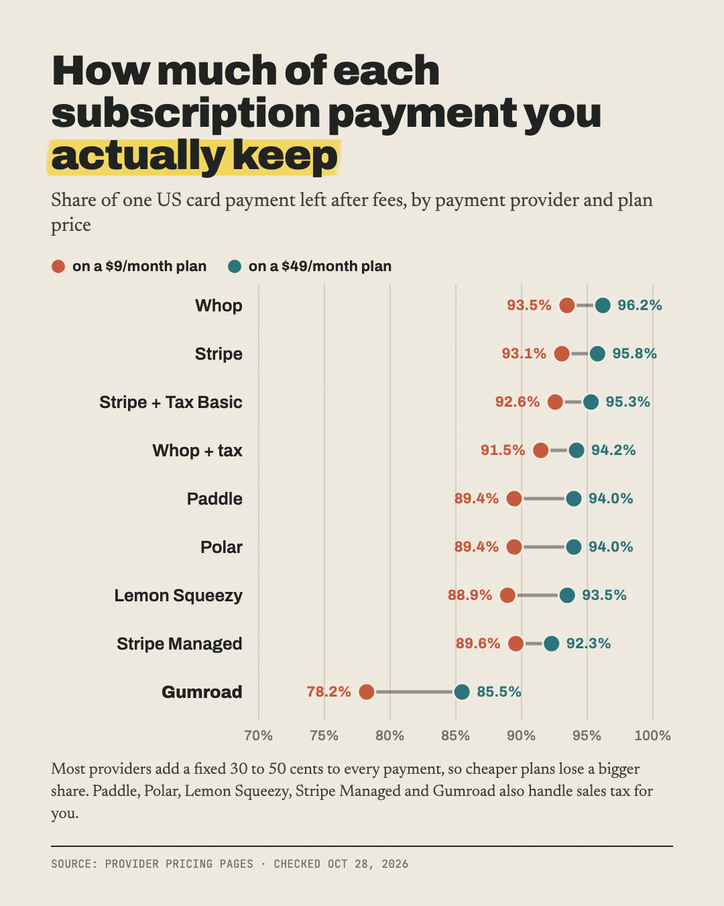

# What you keep from a subscription payment on 9 payment setups

**Plain Stripe leaves you about 95% of a $24 payment and Gumroad about 84%; cheap plans lose the biggest share.**

Part of [The Actuals](https://readtheactuals.com), research on the real numbers behind small online businesses. [Get the next study by email](https://readtheactuals.com).

10 rows:
- the 8 named providers;
- plus Stripe with Stripe Tax Basic;
- plus Whop shown twice, without and with its tax handling.

FastSpring's figure is blank because it only gives prices by quote.

**Assumption:** one renewal charged to a US card, with no sales tax added.

## Findings
1. **Plain Stripe (card + Billing) keeps $22.84 of $24**, losing 4.85% to fees.
   - The cheapest public merchants of record (they collect and pay sales tax for you), Paddle and Polar Starter, keep $22.30.
   - Outsourcing sales tax therefore costs $0.54 per charge, or $6.48 per subscriber per year.
2. **Stripe Managed Payments** (3.5% on top of card and Billing) keeps $22.00, $0.30 less than Paddle. **Lemon Squeezy** keeps $22.18, because of its extra 0.5% on subscriptions.
3. **Gumroad keeps $20.10**, losing 16.23%, more than 3x plain Stripe. That is $2.74 less per charge, or $32.88 per subscriber per year.

## Unverified
- **FastSpring:** no published rate.
- **Whop:** its 0.5% Billing fee says "when enabled", and it's unclear whether subscriptions require it. Without that fee, Whop keeps $23.05.
- **Stripe Managed Payments:** assumes the 0.7% Billing fee also applies.
- **Tax-inclusive totals:** in states that tax software, merchant-of-record fees run slightly higher because they are charged on the total including tax.

## Files

- `data.csv (10 rows)`
- `sources.md`

## License

Data: [CC BY 4.0](https://creativecommons.org/licenses/by/4.0/), credit "The Actuals, readtheactuals.com". Code: MIT. Prices, fees and company names are facts and trademarks of their owners.
